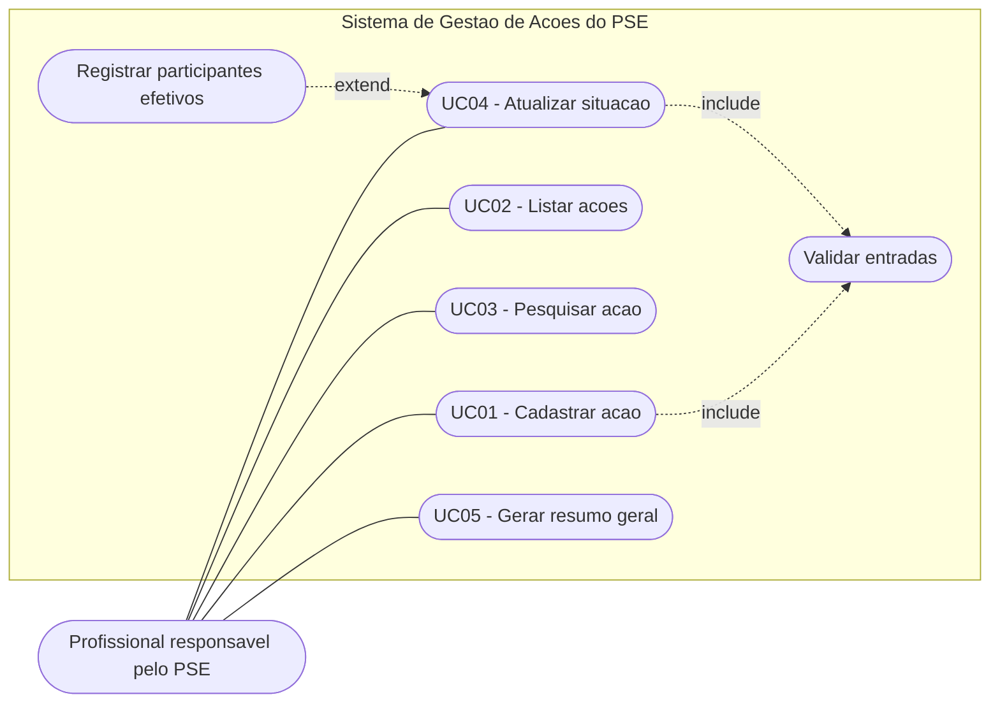

# Casos de uso

> Rascunho para o grupo revisar. O ator e os textos devem ficar iguais aos usuários e requisitos definidos na 1ª entrega.

## Ator

**Profissional responsável pelo PSE:** pessoa da escola ou da unidade de saúde que organiza as ações do programa, por exemplo um coordenador pedagógico ou um profissional da equipe de saúde.

## Diagrama

O diagrama acima é uma representação em fluxograma. No documento final, refaça em uma ferramenta de UML (por exemplo draw.io ou Astah), com o ator em forma de boneco e os casos de uso em elipses.

## UC01 - Cadastrar ação

| Item | Descrição |
|---|---|
| Objetivo | Registrar uma nova ação do PSE no sistema. |
| Ator | Profissional responsável pelo PSE. |
| Pré-condições | O sistema está aberto no menu principal e há menos de 50 ações cadastradas. |
| Pós-condições | A ação fica armazenada em memória e aparece na listagem, na pesquisa e no resumo. |

**Fluxo principal**

1. O ator escolhe a opção 1 no menu.
2. O sistema pede o código da ação.
3. O ator informa um código que ainda não foi usado.
4. O sistema pede escola, tema, data prevista, público-alvo, responsável e quantidade prevista de participantes.
5. O ator informa cada dado.
6. O sistema pede a situação inicial.
7. O ator escolhe planejada, realizada ou cancelada.
8. O sistema grava a ação e mostra a mensagem de confirmação.

**Fluxos alternativos**

- **Limite atingido (passo 1):** se já existem 50 ações, o sistema avisa e volta ao menu.
- **Código repetido (passo 3):** o sistema avisa que o código já existe e pede outro.
- **Código ou quantidade inválidos (passos 3 e 5):** se o valor for negativo, zero ou não for um número, o sistema avisa e pede de novo.
- **Campo vazio (passo 5):** o sistema avisa que o campo é obrigatório e pede de novo.
- **Data inválida (passo 5):** o sistema avisa o formato correto e pede de novo.
- **Situação inexistente (passo 7):** o sistema avisa e pede de novo.
- **Situação inicial realizada (passo 7):** o sistema pede também a quantidade efetiva de participantes.

## UC02 - Listar ações

| Item | Descrição |
|---|---|
| Objetivo | Ver todas as ações cadastradas. |
| Ator | Profissional responsável pelo PSE. |
| Pré-condições | O sistema está aberto no menu principal. |
| Pós-condições | Nenhum dado é alterado. |

**Fluxo principal**

1. O ator escolhe a opção 2 no menu.
2. O sistema mostra o total de ações.
3. O sistema mostra os dados de cada ação, na ordem de cadastro.

**Fluxos alternativos**

- **Nenhuma ação cadastrada (passo 2):** o sistema informa que não há ações e volta ao menu.

## UC03 - Pesquisar ação

| Item | Descrição |
|---|---|
| Objetivo | Localizar rapidamente uma ação por código, escola ou tema. |
| Ator | Profissional responsável pelo PSE. |
| Pré-condições | Há pelo menos uma ação cadastrada. |
| Pós-condições | Nenhum dado é alterado. |

**Fluxo principal**

1. O ator escolhe a opção 3 no menu.
2. O sistema pergunta o tipo de pesquisa: código, escola ou tema.
3. O ator escolhe o tipo.
4. O sistema pede o valor procurado.
5. O ator informa o código, ou um trecho do nome da escola ou do tema.
6. O sistema mostra as ações encontradas.

**Fluxos alternativos**

- **Nenhuma ação cadastrada (passo 1):** o sistema informa e volta ao menu.
- **Tipo inexistente (passo 3):** o sistema avisa e pede de novo.
- **Voltar (passo 3):** o ator escolhe 0 e o sistema volta ao menu.
- **Nada encontrado (passo 6):** o sistema informa que nenhuma ação foi encontrada.

## UC04 - Atualizar situação

| Item | Descrição |
|---|---|
| Objetivo | Mudar a situação de uma ação e registrar os participantes efetivos quando ela for realizada. |
| Ator | Profissional responsável pelo PSE. |
| Pré-condições | A ação já está cadastrada. |
| Pós-condições | A ação passa a ter a nova situação. Se for realizada, guarda a quantidade efetiva de participantes; caso contrário, essa quantidade fica zerada. |

**Fluxo principal**

1. O ator escolhe a opção 4 no menu.
2. O sistema pede o código da ação.
3. O ator informa o código.
4. O sistema mostra os dados atuais da ação.
5. O sistema pede a nova situação.
6. O ator escolhe "realizada".
7. O sistema pede a quantidade efetiva de participantes.
8. O ator informa a quantidade.
9. O sistema grava a alteração e mostra a mensagem de confirmação.

**Fluxos alternativos**

- **Nenhuma ação cadastrada (passo 1):** o sistema informa e volta ao menu.
- **Código inexistente (passo 3):** o sistema avisa que a ação não existe e volta ao menu.
- **Situação inexistente (passo 6):** o sistema avisa e pede de novo.
- **Situação planejada ou cancelada (passo 6):** o sistema não pede a quantidade efetiva e segue para o passo 9.
- **Quantidade negativa (passo 8):** o sistema avisa e pede de novo.

## UC05 - Gerar resumo geral

| Item | Descrição |
|---|---|
| Objetivo | Acompanhar o andamento das ações e a participação. |
| Ator | Profissional responsável pelo PSE. |
| Pré-condições | Há pelo menos uma ação cadastrada. |
| Pós-condições | Nenhum dado é alterado. |

**Fluxo principal**

1. O ator escolhe a opção 5 no menu.
2. O sistema conta as ações planejadas, realizadas e canceladas.
3. O sistema soma os participantes previstos e os efetivos.
4. O sistema calcula o percentual de participação: efetivos divididos pelos previstos das ações realizadas.
5. O sistema mostra o resumo.

**Fluxos alternativos**

- **Nenhuma ação cadastrada (passo 1):** o sistema informa e volta ao menu.
- **Nenhuma ação realizada (passo 4):** o sistema mostra as contagens e informa que não há como calcular o percentual.
